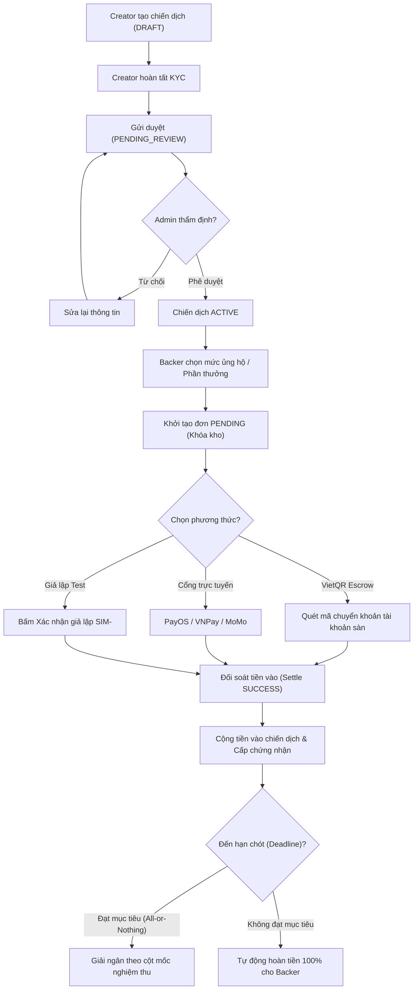
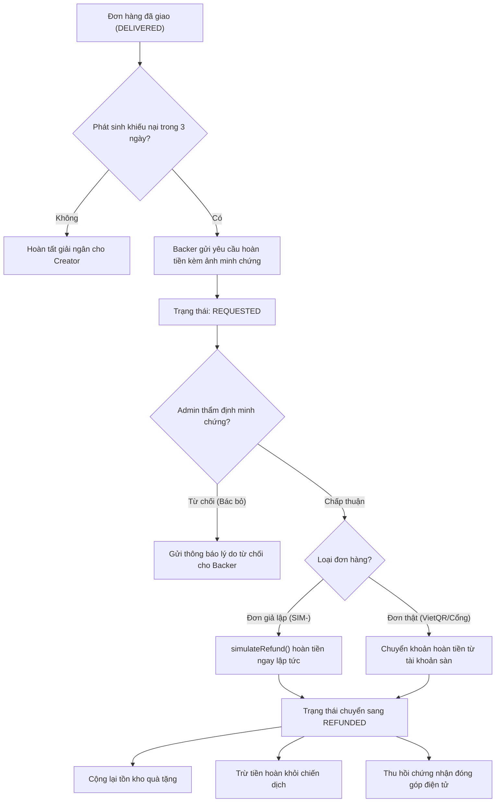

# MẪU YÊU CẦU SẢN PHẨM

## TÊN SẢN PHẨM
Nền tảng Gây quỹ Cộng đồng Minh bạch TửTế Fund (TuTeFund)

## TÁC GIẢ
**Nhóm 02 — Lớp 23CT113 — Trường Đại học Công nghệ Thông tin**
- **Nguyễn Quách Phú Tài** (MSSV: 123000609) — Trưởng nhóm QA / Product Owner
- **Trần Xuân Ân** — Kỹ sư Kiểm thử / Developer
- **Bùi Đặng Quốc Khánh** — Kỹ sư Kiểm thử / Developer
- **Nguyễn Trung Tiến** — Kỹ sư Kiểm thử / Developer
- **Nguyễn Khánh Du** — Kỹ sư Kiểm thử / Developer

## ĐIỆN THOẠI
+84 987 654 321

## E-MAIL
crowdfunding.tute@gmail.com

## ĐỊA CHỈ
Khu phố 6, Phường Linh Trung, TP. Thủ Đức, TP. Hồ Chí Minh

## NGÀY
29/10/2026

## TỔNG QUAN
TuTeFund là nền tảng gây quỹ cộng đồng (Crowdfunding Platform) minh bạch dành cho thị trường Việt Nam. Nền tảng giải quyết bài toán thiếu niềm tin trong quyên góp từ thiện và đầu tư dự án sáng tạo thông qua các cơ chế công nghệ tiên tiến:
1. **Tài khoản ký quỹ trung gian (Escrow Bank Account):** Tiền ủng hộ được giữ tại tài khoản trung gian của sàn với mã VietQR tự động, không chuyển thẳng cho người tạo chiến dịch.
2. **Mô hình gây quỹ chuẩn quốc tế:** Hỗ trợ mô hình *All-or-Nothing* (chỉ giải ngân khi đạt 100% mục tiêu tại hạn chót; nếu không đạt, hoàn tiền tự động 100% cho người ủng hộ) và mô hình *Flexible* (nhận theo tiến độ).
3. **Giải ngân theo cột mốc (Milestone Disbursement):** Creator chỉ được rút tiền theo từng giai đoạn sau khi cung cấp bằng chứng nghiệm thu được Admin thẩm định.
4. **Hệ thống giả lập thanh toán & đối soát toàn diện (Simulation Mode):** Cho phép đội ngũ QA/Admin kiểm thử toàn bộ luồng quyên góp, giao vận và hoàn tiền mà không cần phát sinh giao dịch tiền thật.
5. **Theo dõi đơn hàng & Minh chứng hoàn tiền:** Giao diện bưu cục 4 mốc rõ ràng, cơ chế khiếu nại hoàn tiền kèm bằng chứng ảnh tải lên Cloudinary.
6. **Hệ thống trò chuyện thời gian thực:** Kết nối người ủng hộ và người tạo dự án, lưu trữ đồng bộ trên Neon PostgreSQL.

## MỤC TIÊU SẢN PHẨM
- **Mục tiêu 1 (Minh bạch 100%):** 100% dòng tiền quyên góp được đối soát và công khai sao kê tài chính cho từng chiến dịch.
- **Mục tiêu 2 (Bảo vệ người ủng hộ):** Áp dụng chính sách hoàn tiền 100% nếu chiến dịch All-or-Nothing không đạt mục tiêu hoặc có gian lận.
- **Mục tiêu 3 (Tiện lợi & Nhanh chóng):** Hỗ trợ chuyển khoản nhanh VietQR tự động điền nội dung đối soát, thanh toán qua PayOS/MoMo/VNPay và COD.
- **Mục tiêu 4 (Khả năng kiểm thử tối đa):** Tích hợp sẵn cơ chế giả lập thanh toán (Simulated Settle/Refund) giúp kiểm thử toàn diện mọi kịch bản biên và bảo mật.
- **Mục tiêu 5 (Hiệu năng cao & Sẵn sàng di động):** Thời gian phản hồi API < 500ms, giao diện tương thích 100% thiết bị di động (Responsive >= 375px).

## XÁC ĐỊNH CÁC BÊN LIÊN QUAN
| TÊN / VAI TRÒ | ĐẠI DIỆN | TRÁCH NHIỆM CHÍNH | QUYỀN HẠN & LỢI ÍCH TRÊN HỆ THỐNG |
|:---|:---|:---|:---|
| **Người ủng hộ (Backer)** | Cộng đồng, Nhà hảo tâm | Tìm kiếm dự án, quyên góp tiền, chọn gói quà, nhận chứng từ và khiếu nại | Xem sao kê, nhận mã VietQR thanh toán, theo dõi vận đơn quà, yêu cầu hoàn tiền |
| **Người tạo dự án (Creator)** | Cá nhân, Tổ chức gây quỹ | Soạn thảo chiến dịch, cấu hình phần thưởng, cập nhật tiến độ, gửi hồ sơ KYC | Tiếp cận nguồn vốn cộng đồng, chat với backers, nhận giải ngân theo mốc nghiệm thu |
| **Quản trị viên (Admin)** | Ban quản trị TuTeFund | Kiểm duyệt chiến dịch, thẩm định KYC, duyệt hoàn tiền, quản lý đối soát | Toàn quyền kiểm soát hệ thống, khóa tài khoản vi phạm, bật/tắt chế độ giả lập test |
| **Đơn vị vận chuyển (Carrier)** | GHN, GHTK, Viettel Post | Vận chuyển phần thưởng vật lý đến người nhận | Đồng bộ trạng thái giao vận, cập nhật mã trackingNumber |
| **Đối tác thanh toán (Payment)** | VietQR, PayOS, VNPay, MoMo | Xử lý cổng thanh toán trực tuyến, chuyển khoản ngân hàng | Xử lý giao dịch ký quỹ, gửi Webhook callback đối soát tự động |
| **Đội ngũ Kiểm thử (QA Team)** | Nhóm 02 (23CT113) | Lập Test Plan, thiết kế Test Cases, thực thi kiểm thử và lập báo cáo chất lượng | Sử dụng chế độ giả lập để kiểm tra toàn bộ luồng nghiệp vụ không rủi ro tài chính |

## YÊU CẦU CHỨC NĂNG

Hệ thống bao gồm 11 module chức năng cốt lõi được đối chiếu trực tiếp từ mã nguồn thực tế:

### 1. Phân hệ Xác thực & Quản lý Tài khoản (AUTH)
- **FR-AUTH-01 (Đăng ký tài khoản):** Cho phép người dùng đăng ký tài khoản bằng email, mật khẩu (>= 8 ký tự), họ tên; mật khẩu băm bảo mật bằng bcrypt 10 rounds; gán mặc định role BACKER và status NORMAL. Căn cứ: `src/app/auth/register/page.tsx`, `src/app/api/auth/register/route.ts`.
- **FR-AUTH-02 (Đăng nhập & Phiên):** Xác thực email/mật khẩu qua NextAuth Credentials Provider, cấp JWT cookie chứa id, role, isAdmin. Căn cứ: `src/app/auth/login/page.tsx`, `src/auth.config.ts`.
- **FR-AUTH-03 (Đăng xuất an toàn):** Thu hồi session cookie, vô hiệu hóa phiên đăng nhập. Căn cứ: `src/app/api/auth/signout`.
- **FR-AUTH-04 (Khôi phục mật khẩu):** Gửi liên kết chứa token đặt lại mật khẩu có hiệu lực 1 giờ vào email người dùng; lưu trong bảng `password_resets`. Căn cứ: `src/app/auth/forgot-password/page.tsx`.
- **FR-AUTH-05 (Cập nhật hồ sơ):** Cho phép chỉnh sửa thông tin cá nhân, số điện thoại, tải ảnh đại diện lên Cloudinary (giới hạn <= 5MB). Căn cứ: `src/app/dashboard/profile/page.tsx`.
- **FR-AUTH-06 (Phân quyền RBAC):** Chặn người dùng thường vào trang quản trị `/dashboard/admin`, bảo vệ API quản trị bằng middleware và helper `isAdminActor`. Căn cứ: `src/middleware.ts`, `src/lib/payment/simulate-checkout.ts`.

### 2. Phân hệ Quản lý Chiến dịch gây quỹ (CAMP)
- **FR-CAMP-01 (Tạo chiến dịch DRAFT):** Khởi tạo chiến dịch với tiêu đề, mô tả, mục tiêu (> 0đ), thời hạn kết thúc (> ngày hiện tại), ảnh đại diện; lưu trạng thái DRAFT. Căn cứ: `src/app/campaigns/create/page.tsx`.
- **FR-CAMP-02 (Mô hình gây quỹ):** Áp dụng 2 mô hình: *All-or-Nothing* (chỉ nhận tiền khi đạt 100% mục tiêu tại deadline) và *Flexible* (nhận số tiền thực nhận). Căn cứ: `src/lib/campaign/apply-funding-model-update.ts`.
- **FR-CAMP-03 (Cột mốc giải ngân):** Creator thiết lập các mốc giải ngân kèm tỷ lệ % (tổng đúng 100%) và tài liệu nghiệm thu. Căn cứ: `src/lib/campaign/campaign-milestones.ts`.
- **FR-CAMP-04 (Quy trình kiểm duyệt):** Creator gửi duyệt (PENDING_REVIEW), Admin thẩm định và bấm Duyệt (ACTIVE) hoặc Từ chối (REJECTED) kèm văn bản giải trình. Căn cứ: `src/app/api/campaigns/[slug]/submit/route.ts`.
- **FR-CAMP-05 (Bản tin tiến độ):** Creator đăng tải bài viết nhật ký tiến độ sử dụng trình soạn thảo TipTap Rich-Text. Căn cứ: `src/app/campaigns/[slug]/updates/page.tsx`.
- **FR-CAMP-06 (Đóng chiến dịch tự động):** Cron job quét hạn chót mỗi ngày để chuyển trạng thái SUCCEEDED hoặc FAILED; khóa không nhận thêm ủng hộ. Căn cứ: `src/app/api/cron/campaign-deadline/route.ts`.

### 3. Phân hệ Phần thưởng & Gói hội viên (REWARD)
- **FR-REWARD-01 (Tạo phần thưởng):** Hỗ trợ phần thưởng vật lý (PHYSICAL) có tồn kho và quà tặng số (DIGITAL). Căn cứ: `src/app/api/rewards/create/route.ts`.
- **FR-REWARD-02 (Khóa giữ tồn kho):** Khi đơn hàng PENDING được tạo, hệ thống tự động trừ stock khả dụng (`stockReserved = true`); hoàn trả tồn kho nếu hủy đơn. Căn cứ: `src/lib/payment/create-pledge.ts`, `src/lib/payment/refund.ts`.
- **FR-REWARD-03 (Gói hội viên định kỳ):** Cấu hình các gói `support_tiers` với mức phí hàng tháng và quyền lợi độc quyền. Căn cứ: `src/components/profile/SupportTiersPanel.tsx`.
- **FR-REWARD-04 (Kích hoạt hội viên):** Kích hoạt bản ghi `memberships` với status ACTIVE, hạn dùng 30 ngày sau khi thanh toán thành công. Căn cứ: `src/lib/membership.ts`.
- **FR-REWARD-05 (Hủy gói hội viên):** Chuyển trạng thái sang CANCELED kèm `canceledAt`, không gia hạn kỳ tiếp theo. Căn cứ: `src/lib/payment/refund.ts`.

### 4. Phân hệ Cổng Thanh toán & Ký quỹ (PAY)
- **FR-PAY-01 (Tạo đơn ủng hộ):** Khởi tạo đơn `pledges` trạng thái PENDING với mã giao dịch duy nhất, tính toán phụ phí và tiền tip tự nguyện. Căn cứ: `src/app/api/checkout-sessions/route.ts`.
- **FR-PAY-02 (Chuyển khoản VietQR giữ hộ):** Sinh ảnh VietQR động với thông tin tài khoản trung gian của sàn và cú pháp đối soát `TUTE <mã đơn>`. Căn cứ: `src/app/thanh-toan/chuyen-khoan/page.tsx`, `src/lib/payment/escrow-account.ts`.
- **FR-PAY-03 (Cổng PayOS/MoMo/VNPay):** Tích hợp cổng thanh toán trực tuyến, tiếp nhận webhook callback và xác thực chữ ký HMAC bảo mật. Căn cứ: `src/app/api/payment/payos/create/route.ts`.
- **FR-PAY-04 (Thanh toán khi nhận hàng COD):** Hỗ trợ giao quà vật lý thu tiền tận nơi (`isCashOnDelivery = true`). Căn cứ: `src/lib/payment/create-cod-pledge.ts`.
- **FR-PAY-05 (Đối soát đơn hàng):** Hàm `settlePledgeAsPaid` chuyển đơn sang SUCCESS, ghi nhận `paidAmount`, `receivedAt` và cập nhật số tiền huy động chiến dịch. Căn cứ: `src/lib/payment/settle-pledge.ts`.
- **FR-PAY-06 (Khóa ký quỹ an toàn):** Bảo vệ toàn bộ số tiền tại tài khoản trung gian, ngăn chặn creator rút tiền trước khi chiến dịch hoàn tất. Căn cứ: `src/lib/order-fulfillment.ts`.

### 5. Phân hệ Giả lập Thanh toán & Đối soát (SIM)
- **FR-SIM-01 (Chuyển đổi chế độ giả lập):** Admin có quyền Bật/Tắt chế độ giả lập trong Quản trị hệ thống. Căn cứ: `src/lib/platform-settings.ts`.
- **FR-SIM-02 (Xác nhận giả lập trên UI):** Component `SimulatedPaySteps` cho phép bấm nút xác nhận thanh toán giả lập trực tiếp trên màn hình chuyển khoản VietQR. Căn cứ: `src/components/payment/SimulatedPaySteps.tsx`.
- **FR-SIM-03 (Mã giao dịch test SIM-):** Tự động sinh mã giao dịch dạng `SIM-<pledgeId>`, ghi nhận thanh toán mà không phát sinh giao dịch ngân hàng thật. Căn cứ: `src/lib/payment/simulate-checkout.ts`.
- **FR-SIM-04 (Hạch toán tiến độ test):** Cộng dồn số tiền giả lập vào thanh tiến độ chiến dịch để kiểm tra giao diện. Căn cứ: `src/lib/payment/simulate-checkout.ts`.
- **FR-SIM-05 (Dọn dẹp dữ liệu giả lập):** Nút 'Dọn dẹp giả lập' gọi `wipeSimulatedPledges` để xóa sạch đơn test `SIM-`, hoàn kho và khôi phục dữ liệu thực tế. Căn cứ: `src/app/api/admin/simulation/route.ts`.

### 6. Phân hệ Quản lý Vận chuyển & Giao hàng (SHIP)
- **FR-SHIP-01 (Danh sách đơn hàng):** Trang `/don-hang` hiển thị tất cả các đơn hàng của người mua kèm tab lọc: Tất cả, Đang giao, Hoàn tất. Căn cứ: `src/app/don-hang/page.tsx`.
- **FR-SHIP-02 (Theo dõi 4 mốc giao vận):** Trang `/don-hang/[pledgeId]` hiển thị 4 bước: Đã lên đơn -> Đang chuẩn bị -> Đang vận chuyển -> Đã nhận hàng. Căn cứ: `src/app/don-hang/[pledgeId]/page.tsx`.
- **FR-SHIP-03 (Cập nhật vận đơn):** Ghi nhận đơn vị vận chuyển (`shippingProvider`), mã vận đơn (`trackingNumber`) và thời gian giao bưu cục (`handedToCarrierAt`). Căn cứ: `src/lib/payment/simulate-shipping.ts`.
- **FR-SHIP-04 (Giả lập tiến trình giao hàng):** Component `ShipmentActions` cho phép Admin chuyển nhanh trạng thái PROCESSING -> SHIPPED -> DELIVERED. Căn cứ: `src/components/orders/ShipmentActions.tsx`.
- **FR-SHIP-05 (Xử lý sự cố giao vận):** Ghi nhận trạng thái `DELIVERY_FAILED`, `RETURNING`, `RETURNED` kèm lý do giao thất bại. Căn cứ: `src/lib/payment/simulate-shipping.ts`.

### 7. Phân hệ Khiếu nại & Hoàn tiền (REFUND)
- **FR-REFUND-01 (Quy tắc hoàn tiền):** Kiểm tra điều kiện hợp lệ (`refund-rules.ts`), giới hạn trong thời hạn 3 ngày sau nhận hàng hoặc chiến dịch bị hủy. Căn cứ: `src/lib/payment/refund-rules.ts`.
- **FR-REFUND-02 (Người mua gửi khiếu nại):** Form `RefundActions` cho phép nhập lý do, tải ảnh minh chứng hỏng hóc lên Cloudinary (`refundStatus = REQUESTED`). Căn cứ: `src/components/orders/RefundActions.tsx`, `src/lib/payment/refund-evidence.ts`.
- **FR-REFUND-03 (Admin phê duyệt/từ chối):** Admin kiểm tra ảnh minh chứng, bấm Duyệt (APPROVED) hoặc Từ chối (REJECTED) kèm lý do giải thích. Căn cứ: `src/app/api/orders/[pledgeId]/refund/route.ts`.
- **FR-REFUND-04 (Hoàn tiền giả lập ngay):** Với đơn test SIM-, nút 'Hoàn tiền giả lập ngay' chuyển trạng thái sang REFUNDED tức thì không cần cổng ngân hàng. Căn cứ: `src/lib/payment/refund.ts: simulateRefund`.
- **FR-REFUND-05 (Hoàn kho & trừ tiền quỹ):** Tự động cộng lại số lượng tồn kho phần thưởng (`reward.stock`) và trừ số tiền hoàn khỏi số tiền huy động chiến dịch. Căn cứ: `src/lib/payment/refund.ts`.
- **FR-REFUND-06 (Thu hồi chứng từ & hủy gói):** Tự động thu hồi chứng nhận đóng góp điện tử và hủy gói hội viên liên kết. Căn cứ: `src/lib/payment/refund.ts`.

### 8. Phân hệ Tin nhắn & Hội thoại trực tuyến (CHAT)
- **FR-CHAT-01 (Tìm kiếm người dùng):** Tìm kiếm theo tên/email, xử lý an toàn giá trị null, trả về danh sách đối thoại. Căn cứ: `src/services/pg/chat.service.ts: searchUsers`.
- **FR-CHAT-02 (Phòng chat 1-1 PostgreSQL):** Tạo hoặc tải phòng trò chuyện giữa 2 người dùng trong DB PostgreSQL Prisma, serialize `_id` dạng chuỗi string chuẩn. Căn cứ: `src/app/api/chat/conversations/route.ts`.
- **FR-CHAT-03 (Gửi tin nhắn văn bản):** Lưu trữ tin nhắn vào bảng `messages`, hiển thị tức thì trên giao diện chat. Căn cứ: `src/services/pg/chat.service.ts`.
- **FR-CHAT-04 (Đính kèm hình ảnh):** Cho phép tải ảnh lên Cloudinary và đính kèm vào tin nhắn. Căn cứ: `src/app/api/chat/upload/route.ts`.
- **FR-CHAT-05 (Đánh dấu đã đọc):** Cập nhật `lastReadAt`, xóa badge số tin chưa đọc khi mở hội thoại. Căn cứ: `src/app/api/chat/[id]/read/route.ts`.
- **FR-CHAT-06 (Ghi chú cuộc trò chuyện):** Cho phép Creator/Admin lưu ghi chú nội bộ về người ủng hộ trong bảng `chat_notes`. Căn cứ: `src/app/api/chat/notes/route.ts`.

### 9. Phân hệ Blog & Tương tác Cộng đồng (BLOG)
- **FR-BLOG-01 (Soạn bài viết Rich-Text):** Viết bài chia sẻ với trình soạn thảo TipTap (tiêu đề, ảnh bìa, nhúng video, danh mục, tags). Căn cứ: `src/app/blog/create/page.tsx`.
- **FR-BLOG-02 (Kiểm duyệt bài viết):** Admin duyệt bài PENDING sang PUBLISHED hoặc từ chối REJECTED. Căn cứ: `src/app/api/blog/posts/[id]/review/route.ts`.
- **FR-BLOG-03 (Xem bài viết & Tăng lượt xem):** Trang `/blog/[slug]` hiển thị nội dung chi tiết và tự động tăng `viewCount`. Căn cứ: `src/app/blog/[slug]/page.tsx`.
- **FR-BLOG-04 (Bình luận đa cấp):** Hỗ trợ bình luận và trả lời lồng nhau (`parentId`) tại `BlogCommentSection`. Căn cứ: `src/components/blog/BlogCommentSection.tsx`.
- **FR-BLOG-05 (Thích bài viết):** Tính năng Like/Unlike bài viết, chống spam like trùng lặp. Căn cứ: `src/app/api/blog/posts/[id]/like/route.ts`.

### 10. Phân hệ Định danh KYC & Chứng từ Pháp lý (KYC)
- **FR-KYC-01 (Nộp hồ sơ định danh):** Người dùng nộp số CCCD 12 số, tải ảnh 2 mặt hoặc giấy phép kinh doanh tổ chức. Căn cứ: `src/app/kyc/submit/page.tsx`.
- **FR-KYC-02 (Thẩm định hồ sơ):** Admin kiểm tra giấy tờ, bấm Duyệt (APPROVED) hoặc Từ chối kèm lý do. Căn cứ: `src/app/dashboard/admin/kyc/page.tsx`.
- **FR-KYC-03 (Ràng buộc KYC bắt buộc):** Chặn người dùng chưa KYC không được mở chiến dịch nhận tiền gây quỹ. Căn cứ: `src/lib/permissions.ts`.
- **FR-KYC-04 (Cấp chứng nhận đóng góp):** Cấp mã chứng nhận điện tử duy nhất tra cứu tại `/chung-tu/[code]`. Căn cứ: `src/app/chung-tu/[code]/page.tsx`.
- **FR-KYC-05 (Hóa đơn tài chính GTGT):** Xuất mã hóa đơn `backer_invoices`, tra cứu tại `/hoa-don/[invoiceNumber]`. Căn cứ: `src/app/hoa-don/[invoiceNumber]/page.tsx`.

### 11. Phân hệ Bảng điều khiển Quản trị Hệ thống (ADMIN)
- **FR-ADMIN-01 (Dashboard tài chính):** Thống kê tổng tiền gây quỹ, doanh thu phí sàn, tiền ký quỹ, tăng trưởng người dùng. Căn cứ: `src/app/dashboard/admin/page.tsx`.
- **FR-ADMIN-02 (Quản lý người dùng):** Tìm kiếm, phân quyền (BACKER/CREATOR), khóa tài khoản vi phạm (SUSPENDED). Căn cứ: `src/app/dashboard/admin/users/page.tsx`.
- **FR-ADMIN-03 (Xử lý báo cáo vi phạm):** Tiếp nhận khiếu nại tố cáo từ cộng đồng, xử lý vi phạm hoặc bác bỏ. Căn cứ: `src/app/dashboard/admin/reports/page.tsx`.
- **FR-ADMIN-04 (Sao kê chiến dịch):** Xuất bảng kê đối soát minh bạch các khoản thu - chi - hoàn của chiến dịch. Căn cứ: `src/app/api/campaigns/[slug]/accounting/route.ts`.
- **FR-ADMIN-05 (Quản lý danh mục):** Thêm, sửa, xóa danh mục và tags của nền tảng. Căn cứ: `src/app/dashboard/admin/categories/page.tsx`.

## YÊU CẦU PHI CHỨC NĂNG
- **NFR-01 (Hiệu năng):** Thời gian phản hồi 95% API < 500ms; trang chủ và chi tiết dự án tải trong < 1.5 giây. Sử dụng Next.js Cache và Connection Pooling Neon PostgreSQL.
- **NFR-02 (Bảo mật):** Mật khẩu băm Bcrypt 10 rounds; chống SQL Injection 100% bằng Prisma ORM parameterized queries; lọc mã độc XSS bằng DOMPurify; chống CSRF với SameSite cookies.
- **NFR-03 (Toàn vẹn dữ liệu ACID):** Mọi giao dịch thay đổi tiền bạc, trừ kho và hạch toán đều thực thi trong `prisma.$transaction`, tự động rollback nếu gặp sự cố.
- **NFR-04 (Tính tương thích):** Tương thích 100% các trình duyệt phổ biến (Google Chrome, Microsoft Edge, Mozilla Firefox, Apple Safari) và responsive mượt mà từ màn hình di động 375px trở lên.
- **NFR-05 (Quốc tế hóa & Giao diện):** Hỗ trợ chuyển đổi 2 ngôn ngữ Tiếng Việt (vi) và Tiếng Anh (en); hỗ trợ chế độ giao diện Sáng / Tối (Light / Dark mode).

## GIẢ ĐỊNH VÀ RÀNG BUỘC
### Giả định
1. Người dùng có tài khoản ngân hàng hoặc ví điện tử quét được mã chuẩn VietQR Napas 247.
2. Quản trị viên và người tạo dự án có kết nối internet ổn định để quản trị và cập nhật tiến độ.
3. Nhà cung cấp hạ tầng Cloudinary và Neon PostgreSQL duy trì độ sẵn sàng SLA >= 99.9%.

### Ràng buộc
1. **Công nghệ:** Xây dựng trên nền tảng Next.js 15 (App Router), React 19, TypeScript 5, Tailwind CSS, Prisma ORM 5.
2. **Cơ sở dữ liệu:** Cơ sở dữ liệu quan hệ PostgreSQL (Neon Serverless Postgres).
3. **Pháp lý:** Tuân thủ Nghị định 93/2021/NĐ-CP về vận động, tiếp nhận, phân phối và sử dụng các nguồn đóng góp tự nguyện; Luật An ninh mạng Việt Nam.

## PHỤ THUỘC
- Dịch vụ Cổng thanh toán VietQR (VietQR.io) và PayOS SDK.
- Dịch vụ lưu trữ đa phương tiện Cloudinary API (lưu ảnh chiến dịch, avatar, bằng chứng hoàn tiền).
- Thư viện xác thực NextAuth v5.
- Cơ sở dữ liệu Neon PostgreSQL.

## TIÊU CHÍ CHẤP NHẬN
- 100% các yêu cầu chức năng (FR) được kiểm thử bằng Test Cases tương ứng.
- Đạt tỷ lệ thực thi thành công (Pass Rate) >= 95%.
- Không còn bất kỳ lỗi mức nghiêm trọng (Critical / High) nào chưa được xử lý.
- Ma trận truy xuất yêu cầu (Requirements Traceability Matrix) bao phủ 100% yêu cầu kiểm thử.

## PHÂN TÍCH RỦI RO
| MÃ RỦI RO | MÔ TẢ RỦI RO | KHẢ NĂNG | ẢNH HƯỞNG | KẾ HOẠCH PHÒNG NGỪA & GIẢM THIỂU |
|:---|:---|:---:|:---:|:---|
| **RSK-01** | Tranh chấp số lượng tồn kho (Race condition) khi nhiều người đặt hàng cùng lúc | Trung bình | Cao | Sử dụng giao dịch nguyên tử `prisma.$transaction` và khóa dòng để đảm bảo số lượng tồn kho không bị âm. |
| **RSK-02** | Webhook ngân hàng bị giả mạo chữ ký số dẫn đến cập nhật đơn ảo | Thấp | Rất cao | Kiểm tra chữ ký HMAC SHA256 trên mọi payload webhook trước khi cập nhật trạng thái đơn sang SUCCESS. |
| **RSK-03** | Dự án lừa đảo mạo danh tổ chức từ thiện | Trung bình | Rất cao | Bắt buộc hoàn thành xác thực CCCD/GPKD (KYC) trước khi mở chiến dịch; tiền được giữ ký quỹ trung gian. |
| **RSK-04** | Sự cố nghẽn mạng khi quét mã VietQR | Trung bình | Trung bình | Tích hợp chế độ giả lập thanh toán (Simulated Settle) cho phép đối soát thủ công hoặc test tự động. |
| **RSK-05** | Tấn công mã độc XSS qua trình soạn thảo Rich-Text của bài viết | Thấp | Cao | Sử dụng thư viện `DOMPurify` lọc sạch toàn bộ thẻ script, iframe lạ trước khi lưu và hiển thị. |

## NỖ LỰC ƯU TIÊN (MA TRẬN MOSCOW)
- **MUST HAVE (Bắt buộc phải có):**
  - Đăng ký, đăng nhập, phân quyền RBAC.
  - Khởi tạo chiến dịch, mô hình All-or-Nothing / Flexible, cột mốc giải ngân.
  - Quản lý phần thưởng và khóa giữ tồn kho (Stock Reservation).
  - Cổng thanh toán VietQR giữ hộ (Escrow), đối soát tiền vào tài khoản trung gian.
  - Giả lập thanh toán, giao vận và hoàn tiền (Simulation Mode).
  - Quy trình khiếu nại hoàn tiền kèm ảnh minh chứng.
  - Hệ thống Chat 1-1 trên PostgreSQL Prisma.
  - Bắt buộc KYC trước khi mở chiến dịch.
- **SHOULD HAVE (Nên có):**
  - Thanh toán cổng trực tuyến PayOS, MoMo, VNPay, COD.
  - Blog cộng đồng, bình luận lồng nhau đa cấp.
  - Tra cứu chứng nhận đóng góp điện tử và hóa đơn tài chính.
  - Quản lý báo cáo vi phạm nội dung (Reports).
- **COULD HAVE (Có thể có):**
  - Chuyển đổi giao diện Sáng / Tối (Dark / Light Theme).
  - Chuyển đổi đa ngôn ngữ Tiếng Việt / Tiếng Anh.
  - Ghi chú nội bộ cho cuộc trò chuyện.
- **WON'T HAVE (Chưa phát triển phiên bản này):**
  - Thanh toán bằng tiền mã hóa (Cryptocurrency / Web3).
  - Ứng dụng di động Native (iOS/Android IPA/APK riêng biệt - sử dụng Responsive Web).

## LỊCH SỬ PHIÊN BẢN VÀ NHẬT KÝ THAY ĐỔI
| PHIÊN BẢN | NGÀY | TÁC GIẢ | NỘI DUNG THAY ĐỔI CHÍNH |
|:---:|:---:|:---|:---|
| **1.0.0** | 15/09/2026 | Nhóm 02 | Khởi tạo tài liệu PRD ban đầu theo đặc tả ý tưởng gây quỹ cộng đồng. |
| **2.0.0** | 20/10/2026 | Nguyễn Quách Phú Tài | Cập nhật cấu trúc đối chiếu mã nguồn thực tế, bổ sung mô hình Escrow VietQR. |
| **3.0.0** | 29/10/2026 | Nguyễn Quách Phú Tài | Viết lại toàn diện theo chuẩn bài giảng của thầy: bổ sung hệ thống giả lập thanh toán SIM-, cơ chế hoàn tiền khiếu nại kèm minh chứng, tích hợp chat PostgreSQL Prisma, 65 TRs và 180 TCs (mỗi thành viên đúng 36 TCs). |

## HỖ TRỢ THỊ GIÁC

### Sơ đồ 1: Luồng Gây quỹ, Ký quỹ và Đối soát thanh toán

### Sơ đồ 2: Luồng Khiếu nại và Hoàn tiền

---
*Tài liệu được phê duyệt bởi Test Lead: Nguyễn Quách Phú Tài — Ngày: 29/10/2026*
